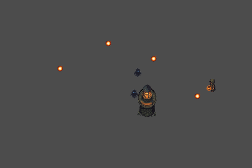
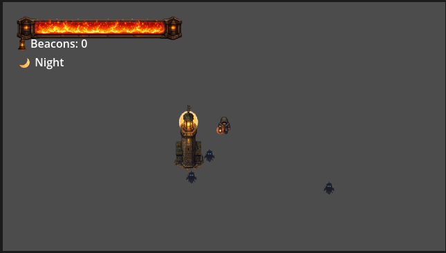

# 🌟 Last Light

> **A 2D top-down survival & base-defense game built with Godot 4.7**

<p align="center">
  
</p>

**Last Light** is a pixel-art survival and base-defense game where you play as **The Keeper**, guardian of the world's final lighthouse.

As darkness engulfs the world, shadow creatures emerge every night to extinguish humanity's last source of light. Defend the lighthouse, collect Beacons from defeated enemies, repair the flame during the day, and survive increasingly dangerous nights.

> 📖 **Story, lore, and design documentation:** `Docs/GameDesign.md`

---

# ✨ Current Features

## 🧍 Player

- 4-direction movement
- Mouse aiming
- Fireball shooting
- Right-click focused light that aims at the cursor, consumes a regenerating Focus meter, and slows enemies in its cone
- Directional sprites
- Interaction prompts for repairs and fixed build sites

---

## ⚔️ Combat

- Projectile collision
- Enemy health system
- Enemy death
- Hit flashes and short impact bursts
- Beacon drops on enemy death
- Automatic beacon collection
- Focused light and the nighttime lighthouse sweep slow Shadow Crawlers

---

## 🏰 Lighthouse

- Central objective
- Health system
- Custom HP Bar
- Repair mechanic
- Repairs restore 5 HP per Beacon
- Cannot repair at full HP
- Repair available only during Day
- Game Over when destroyed
- Visible sweeping beam slows enemies caught by its cone at night

## 🧱 Resources & Defenses

- Salvage caches grant campaign Salvage when collected
- Four fixed build sites show their cost and availability before construction
- Thorn Barricades block enemies, take damage, and break
- Snare Traps damage and briefly immobilize one enemy when triggered
- Ward Lanterns create visible fields that slow nearby Shadow Crawlers
- Press **E** near the Lighthouse to repair or near a build site to construct; repairs and construction are Day-only

---

## 👾 Enemies

### ShadowCrawler

- Moves toward the lighthouse
- Stops and attacks in range
- Periodic damage
- Health system
- Retreats during Dawn
- Despawns after reaching the Veil
- Drops Beacons on death

---

## 🌙 Day & Night Cycle

Current cycle:

```text
☀ Day
   ↓
🌇 Dusk
   ↓
🌙 Night
   ↓
🌅 Dawn
   ↓
☀ Day
```

### Behaviour

| Phase | Behaviour |
|--------|-----------|
| ☀ Day | Repair lighthouse |
| 🌇 Dusk | Transition into darkness |
| 🌙 Night | Enemy spawning begins |
| 🌅 Dawn | Enemies retreat into the Veil |

## Campaign Architecture

`Main.tscn` remains loaded for the run. Its `GameManager` owns the current day and phase, Beacons, Salvage, secured shard IDs, upgrades, lens selection, and lighthouse health. The active location is instanced under `WorldContainer`, so replacing a world does not discard that campaign state. `Scenes/Worlds/LighthouseYard.tscn` is the current starting location.

The prototype starts in Day 1 and follows Day → Dusk → Night → Dawn before advancing to the next day. The manager rejects invalid phase transitions, duplicate shard claims, insufficient resource spending, and repeated Game Over transitions.

---

## 💎 Beacon System

- Beacons drop from defeated enemies
- Automatically collected by the player
- Stored in campaign state
- Required to repair the lighthouse
- One repair consumes one Beacon

---

## 📺 User Interface

- Lighthouse custom HP Bar
- Beacon counter
- Salvage counter
- Focus meter
- Current phase indicator
- Contextual interaction and cost prompts

---

# 🎮 Controls

| Input | Action |
|:------:|--------|
| **W A S D** | Move |
| **Mouse** | Aim |
| **Left Click** | Shoot |
| **Right Click (hold)** | Focus light toward the cursor |
| **E** | Repair the Lighthouse or build at a nearby site |

---

# 🛠 Built With

- Godot Engine **4.7**
- GDScript

---

# 📂 Project Structure

```text
Assets/
    Sprites/
    UI/

Docs/
    Concepts_art/
    GameDesign.md

Scenes/
    Beacon/
    Defenses/
    Enemies/
    Effects/
    EnemySpawner/
    GameManager/
    LightHouse/
    Player/
    Projectiles/
    Resources/
    Worlds/
    HUD.gd

project.godot
```

---

# 🚧 Development Roadmap

## Gameplay

- [ ] Multiple enemy types
- [ ] Progressive difficulty
- [ ] Boss encounters
- [ ] Lighthouse upgrades
- [ ] Crafting & upgrades

## Visuals

- [ ] Dynamic lighting
- [ ] Veil / Fog of Darkness
- [ ] Particle effects
- [ ] Day & Night ambience
- [ ] Camera shake
- [ ] Animated UI

## Audio

- [ ] Background music
- [ ] Ambient sounds
- [ ] Combat SFX

## Polish

- [ ] Main Menu
- [ ] Pause Menu
- [ ] Save System
- [ ] Settings Menu

---

# 🚀 Running the Project

1. Clone the repository.
2. Open the project with **Godot Engine 4.7** or later.
3. Run `main.tscn`.

---

# 📌 Current Progress

### ✅ Implemented

- Player movement
- Combat system
- Lighthouse health & repair
- Enemy AI
- Day/Night cycle
- Enemy retreat system
- Beacon economy
- HUD
- Custom HP Bar
- Game Over system

---

# 📸 Screenshots

## Enemy Spawn

<p align="center">
  
</p>

---

## Combat

<p align="center">
  
</p>

---

## License

This project is currently intended for **educational and portfolio purposes**.

---

## Developer Notes

This project is being developed to learn:

- Game Programming
- Godot Engine
- Gameplay Architecture
- AI Behaviour
- UI Systems
- Pixel Art Workflow
- Software Design
